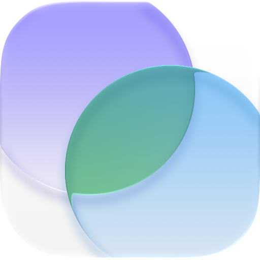
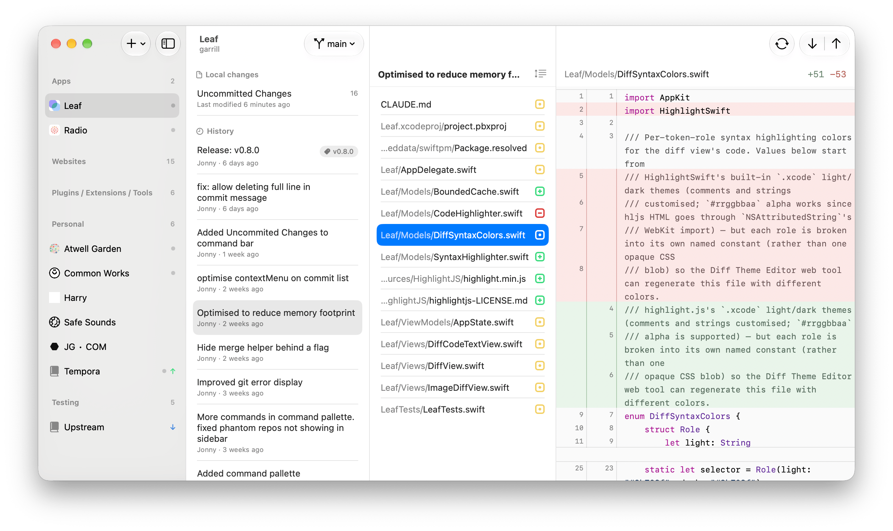
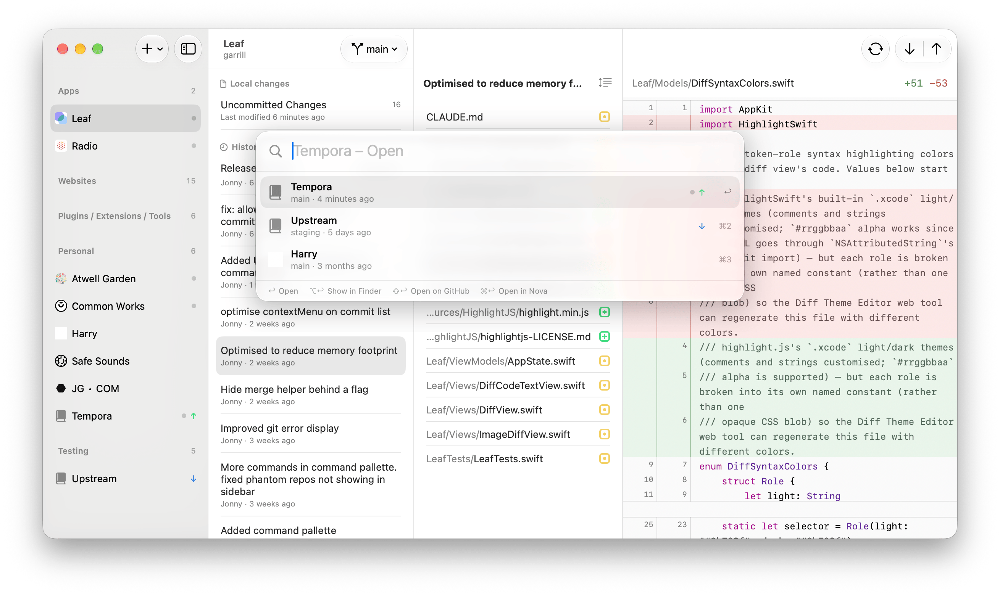

	<picture alt="Leaf app icon">
		<source media="(prefers-color-scheme: dark)" srcset="docs/icon-dark.png">
		
	</picture>

<h1 align="center">Leaf</h1>

A lightweight, native git client for macOS.

Leaf is a free and open-source git client for MacOS. It is based on a four column layout to show repositories, branch history, changed files and file diffs all side-by-side.

This is intentionally a bare-bones and simple to use, best for solo devs / small teams working on repositories with a few branches. It covers the everyday git workflow, but doesn't handle the more complex side of git and there are no plans to add more features.

<picture>
	<source media="(prefers-color-scheme: dark)" srcset="docs/screenshot-dark.png">
	
</picture>

## Download

1. Download the latest `.dmg` from the [Releases page](https://github.com/garrill/Leaf/releases/latest).
2. Open it and drag **Leaf** into your Applications folder.
3. Launch Leaf and add a repository, either from a folder on your Mac or by cloning from a URL.

Leaf is signed and notarized by Apple, and it updates itself: you'll be offered new versions as they come out, or you can choose **Check for Updates…** from the app menu at any time.

**Requirements:** macOS 26 or later, and git. If git isn't installed, Leaf should prompt you ti install it.

## Features

### Keep all your repos in one place
- The sidebar lists all your repos, where you can add local repos or clone new ones.
- Sidebar organisation that you would expect, you can add repos to folders, rename them and pick icons so they are visible at a glance.
- Activity dot in sidebar lets you know if it has uncommited, unpushed or unpulled changes.
- Double click a repo to open it in your code editor.

### Everyday git workflow
- Stage, unstage and commit, with an optional commit description
- Fetch, pull and push, with progress shown as it happens for larger jobs
- Create, switch, merge and delete branches, and prune stale remote branches
- Add, remove and push tags
- Stash your changes and bring them back later
- Discard changes safely: discarded files go to the Trash, so you can get them back
- Ignore files straight from the file list
- Git errors come with a short, plain-English summary, and you can copy the full log when you need the detail

### Diff viewer
- Syntax highlighting
- Word-level highlights that show exactly what changed within a line
- Search inside a diff
- Optionally hide whitespace-only changes
- Image diffs, shown side by side or with a swipe comparison

### Keyboard navigation
- **Command palette (⌘K):** jump to any repo, branch, commit or file, or run a command, all from one search box
- Move between columns with ← and →
- Press Return to commit, and Escape to undo your last commit

### Feels at home on macOS
- Built natively in SwiftUI and AppKit, with Liquid Glass styling
- Light and dark mode
- Lightweight and quick, even on large commits

<picture>
	<source media="(prefers-color-scheme: dark)" srcset="docs/screenshot-dark-command-palette.png">
	
</picture>

## Privacy

Leaf uses the git you have installed already, and it runs entirely on your Mac. It only talks to git and to the remotes you've configured. It doesn't collect or send anything about your repositories, your code or how you use the app.

## Feedback

Leaf is in beta. If you find a bug or have a suggestion, please [open an issue](https://github.com/garrill/Leaf/issues). The [changelog](CHANGELOG.md) lists what's new in each release.

## License

Free and open source under the MIT license. See [LICENSE](LICENSE).
